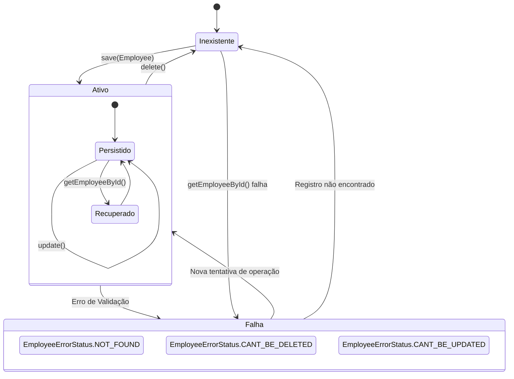
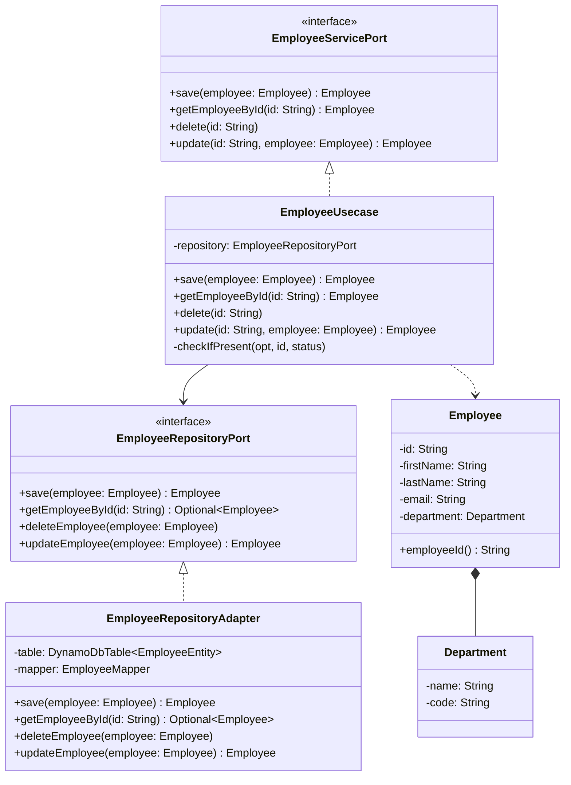
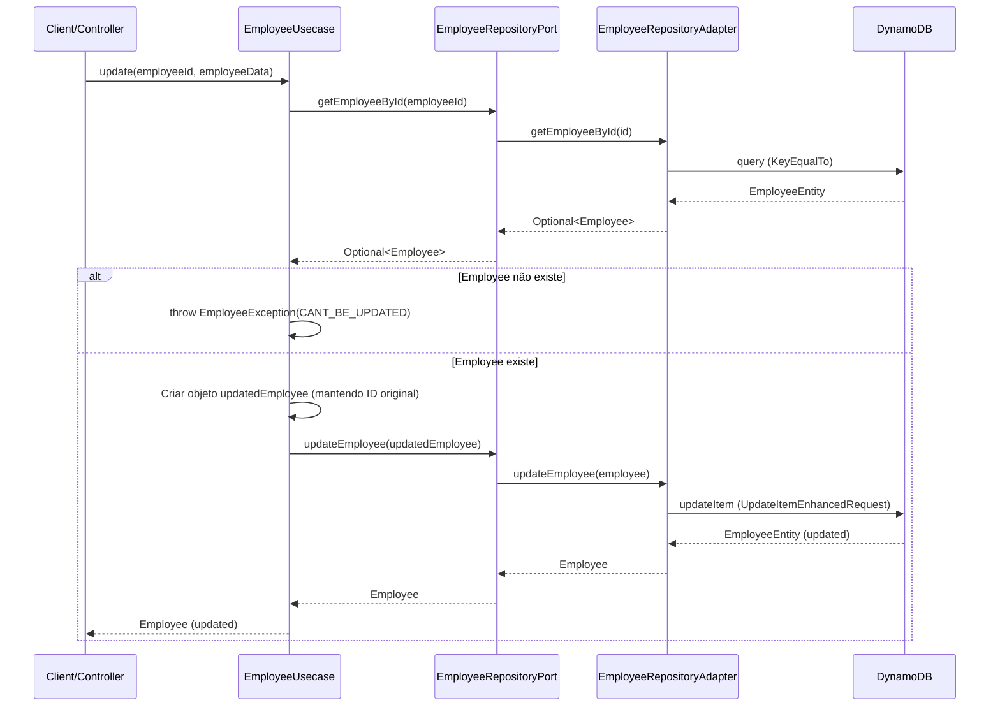

## Visão Geral da Aplicação

A aplicação é um serviço de gerenciamento de funcionários (Employees) que utiliza o Amazon DynamoDB como camada de
persistência. O design foca na separação de responsabilidades, garantindo que a lógica de negócio (domínio) seja
independente de tecnologias externas (infraestrutura).

**Tecnologias Principais:**

* **Linguagem:** Kotlin
* **Framework:** Spring Boot
* **Banco de Dados:** AWS DynamoDB (via AWS SDK v2 Enhanced Client)
* **Arquitetura:** Hexagonal (Clean Architecture)

## Diagrama de Estados

Este diagrama ilustra a representação do estado do registro de um funcionário no sistema.

## Diagrama de Classes

O diagrama abaixo detalha as relações entre as principais classes e interfaces do domínio e infraestrutura.

## Diagrama de Sequência (Fluxo de Atualização)

Este diagrama representa o fluxo lógico quando o método update é chamado no EmployeeUsecase, demonstrando a interação
entre o domínio e o adaptador de infraestrutura.

## Detalhamento das Camadas

### Domínio (`domain`)

* **Models:** `Employee` e `Department` são POJOs (Plain Old Java Objects) que representam a regra de negócio. O uso de
  métodos como `employeeId()` em vez de getters padrão sugere uma abordagem de encapsulamento mais rigorosa.
* **Ports:**
    * `EmployeeServicePort`: Define o que a aplicação pode fazer (Input).
    * `EmployeeRepositoryPort`: Define o que a aplicação precisa do mundo externo para persistência (Output).
* **Exceptions:** `EmployeeException` centraliza o tratamento de erros de negócio usando o enum `EmployeeErrorStatus`.

### Aplicação (`application`)

* Usecases: `EmployeeUsecase` contém a orquestração da lógica. Por exemplo, antes de deletar ou atualizar, ele verifica
  a existência do registro e lança exceções customizadas se necessário.

### Infraestrutura (`infrastructure`)

* Adapters: `EmployeeRepositoryAdapter` implementa a porta de saída. Ele converte objetos de domínio em entidades (
  `EmployeeEntity`) e utiliza o `DynamoDbEnhancedClient` para operações no banco.
* Config: `DynamoDbConfiguration` centraliza a criação dos Beans do SDK da AWS, configurando o endpoint e a região.